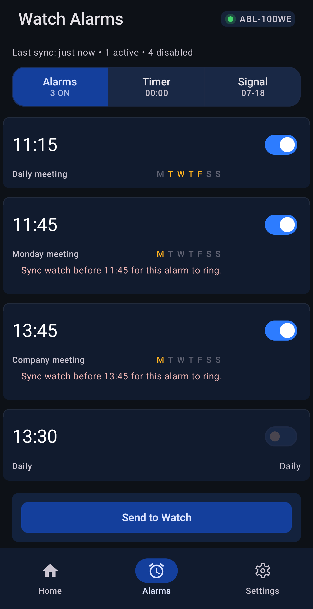
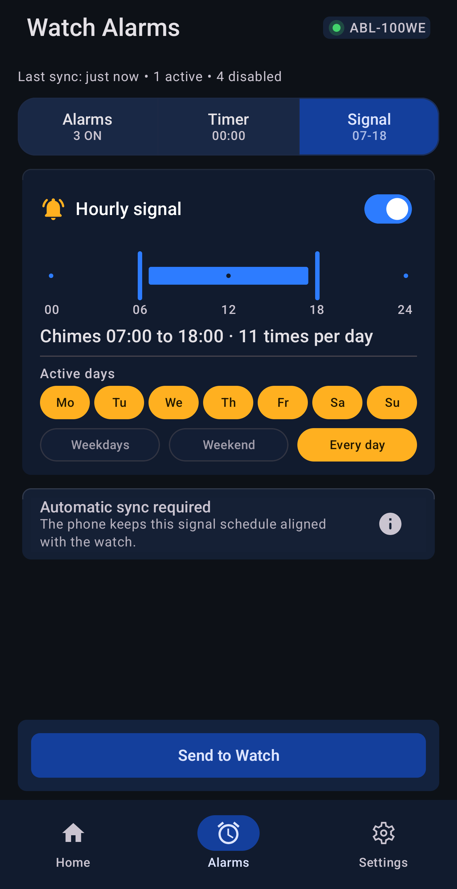
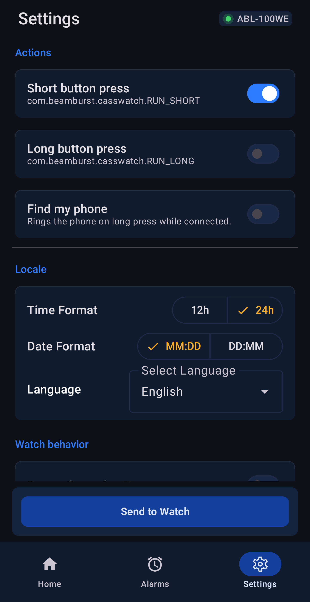
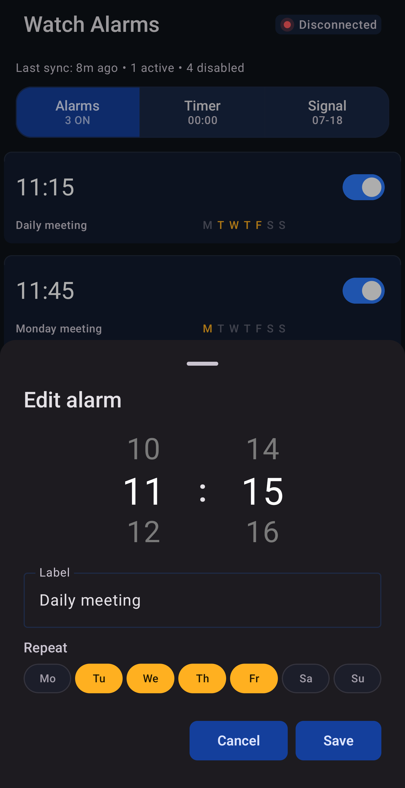
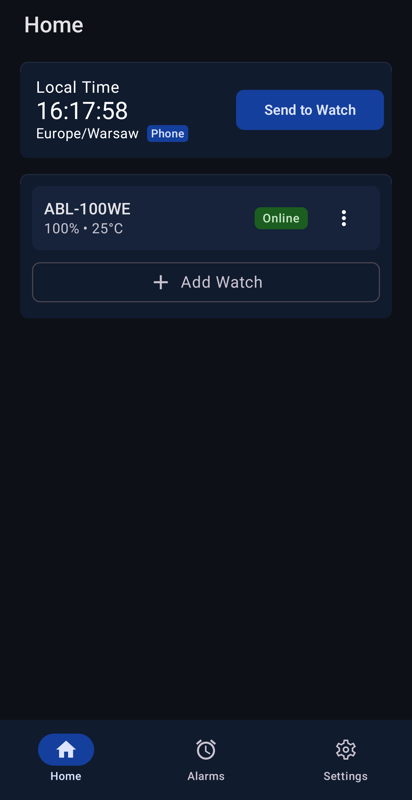
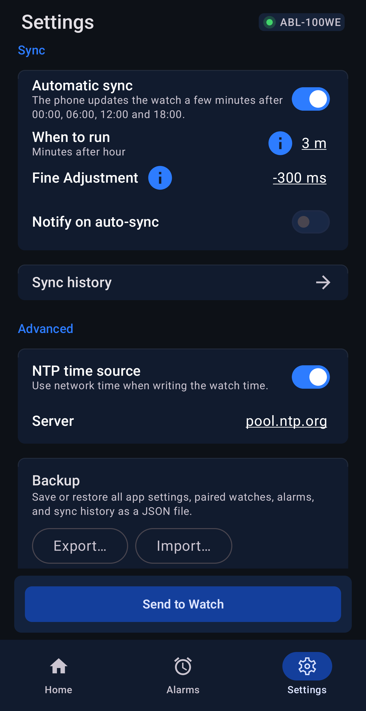

# Cassiopeia Watch

**Weekly and one-time alarms, an hourly chime on your schedule, and watch-button automations for the Casio ABL-100WE.** No Casio account, no cloud, no ads.

<p align="center">
  
  
  
</p>

Cassiopeia Watch is an unofficial, open-source Android app built and tested for the Casio ABL-100WE Bluetooth watch. Other Casio Bluetooth watches that the GShockAPI library recognises may work, but they are not the target devices and are untested.

This project is a derivative of [CasioGShockSmartSync](https://github.com/izivkov/CasioGShockSmartSync) by Ivo Zivkov. It is not affiliated with, endorsed by, or sponsored by Casio Computer Co., Ltd. "Casio", "G-Shock", "Edifice" and "Pro Trek" are trademarks of their respective owners and are used here only to describe compatibility.

Status: experimental prerelease. The first version is 40.10. [Download it from the releases page](https://github.com/cihyboj/cassiopeia-watch/releases), then see [Installation](#installation).

## Highlights

### Weekly alarms



Set each alarm for specific days of the week, or as a one-time alarm, and give it a name. The watch itself only knows daily alarms, so the app applies the right alarms for each day whenever the watch connects.

For this to work without opening the app, turn on **Automatic sync** in Settings. The watch then connects by itself four times a day, at a minute you choose (0–59) after 00:00, 06:00, 12:00 and 18:00, and the app updates the alarms, the hourly signal and the time. If automatic sync is off or a sync fails, an alarm can ring on a day you excluded until the next connection.

### Hourly signal on your schedule

Limit the watch's hourly chime to a time window and to selected days (weekdays, weekend, every day or your own choice). The app can only switch the watch's signal on and off when the watch syncs (00:00, 06:00, 12:00 and 18:00), so the window follows those syncs: the first chime is the hour after a sync and the last is at a sync hour, for example 07:00 to 18:00. The app shows the scheduled chime hours; keeping to them needs **Automatic sync** turned on and successful syncs.

### Watch buttons as automation triggers

A short press and a long press of the watch button that connects it to the phone can each send an Android broadcast that automation apps such as [Tasker](https://tasker.joaoapps.com/), [MacroDroid](https://www.macrodroid.com/) or [Automate](https://llamalab.com/automate/) can react to:

| Press | Broadcast action |
|---|---|
| Short | `com.beamburst.casswatch.RUN_SHORT` |
| Long | `com.beamburst.casswatch.RUN_LONG` |

You can attach your own extras (text, whole number or true/false) to each broadcast, so one automation can handle several cases. Some ideas:

- Start or stop a voice recording, for example for notes while driving or cycling.
- Take a photo remotely: trigger the camera shutter on a phone on a tripod.
- Toggle the lights or a scene in your smart home (Home Assistant, Philips Hue and similar, through your automation app).
- Play or pause music, or skip a track.
- Send your location to a trusted contact, or start a call to them.
- Log something with a timestamp: a medication taken, a workout set, a baby feed.

The app sends the broadcast; the automation app does the rest. The watch has to connect to the phone first, so expect a few seconds' delay, and test any automation you plan to rely on. Do not depend on it as your only way to call for help in an emergency.

A long press can also ring the phone ("Find my phone") at a volume and melody you choose. If the app may post notifications, a notification with a Stop button appears; otherwise press the watch button again, or the ringing stops after 30 seconds. Whether it is audible depends on the phone's sound and Do Not Disturb settings.

## Getting started

<p>
  
  
</p>

1. [Install the APK](#installation) and open the app.
2. Pair the watch with **Add Watch** and accept the system pairing dialog.
3. In Settings, turn on **Automatic sync**, and **Auto-sync on reconnect** if you want the time sent every time the watch connects.
4. Set up alarms, the hourly signal and button actions.

## Other features

- Time: send the phone time, time zone and DST setting to the watch. Optionally use an NTP server as the time source, and apply a fine adjustment in milliseconds.
- Phone alarm backup (optional, off by default): when the app has no confirmation that the watch received an alarm change, it can ask the phone's clock app to set the alarm too. See [Known limitations](#known-limitations).
- Events: send upcoming events from the phone calendar to the watch as reminders, on watches that support reminders. Some recurrence rules are marked incompatible.
- Watch settings: light, power saving, font, locale and similar options, on models that expose them.
- Multiple watches, each with its own local sync history.
- Backup: export and import the app settings as a JSON file.
- The interface is translated into several languages (see `app/src/main/res/values-*`). Some newer strings are English only.

## Compatibility

The app talks to the watch through the [GShockAPI](https://github.com/izivkov/GShockAPI) library, so compatibility depends on that library and on the watch firmware.

Tested:

- Casio ABL-100WE, by the maintainer. This is the only model that has been tested with this app.

Recognised by the library, untested:

- Models listed as supported in the GShockAPI documentation: G(M)W-5600, G(M)W-5000, GA-B2100, GST-B500, MSG-B100, G-B001, GBD-800 (partial support), MRG-B5000, GCW-B5000.
- Models the library has code paths for but does not list in its documentation: DW-H5600, other DW models, GMW-BZ5000, GW-BX5600, GPR, GBD, EQB, ECB-10/20/30.

"Recognised" means only that the library knows the model name. It does not mean the features of this app have been checked on that model.

The app needs Android 8.0 (API 26) or newer, and a phone with Bluetooth Low Energy and companion device pairing support.

## Installation

Cassiopeia Watch is distributed only as an APK attached to a GitHub prerelease of this repository. It is not on Google Play or F-Droid. The package name is `com.beamburst.casswatch`.

1. Download these files from the [releases page](https://github.com/cihyboj/cassiopeia-watch/releases): `cassiopeia-watch-<version>.apk`, `cassiopeia-watch-<version>.apk.sha256` and `signer-sha256.txt`. The release also carries `NOTICE`, `LICENSE` and `THIRD_PARTY_NOTICES.md`.
2. Verify the checksum from the folder that contains both files:
   ```
   sha256sum -c cassiopeia-watch-<version>.apk.sha256
   ```
3. Verify the signer with the Android SDK build tools. Every release is signed with the same certificate, whose SHA-256 digest is:
   ```
   D63C4B494FF1B1867D8A245DFA54F888C87BEED04E63ED40CB32683ADFCB4707
   ```
   Compare it with the `SHA-256 digest` line printed by the command below. The `signer-sha256.txt` file in each release holds the same value, but because it comes with the APK, check against the digest in this README.
   ```
   apksigner verify --print-certs cassiopeia-watch-<version>.apk
   ```
   (`apksigner` prints lower-case hex; compare ignoring case.)
4. Allow your browser or file manager to install unknown apps, then open the APK.

## Permissions

| Permission | Why |
|---|---|
| `BLUETOOTH_SCAN`, `BLUETOOTH_CONNECT` (Android 12 and newer) | Find and talk to the watch. `BLUETOOTH_SCAN` is declared with `neverForLocation`. |
| `BLUETOOTH`, `BLUETOOTH_ADMIN` (Android 11 and older; declared with `maxSdkVersion` 30) | The same, on older Android versions. |
| `ACCESS_COARSE_LOCATION`, `ACCESS_FINE_LOCATION` (Android 11 and older only) | Older Android versions require location permission to deliver Bluetooth scan results. The app does not read or store your location. |
| `REQUEST_COMPANION_PROFILE_WATCH`, `REQUEST_OBSERVE_COMPANION_DEVICE_PRESENCE`, `REQUEST_COMPANION_RUN_IN_BACKGROUND`, `REQUEST_COMPANION_USE_DATA_IN_BACKGROUND` | Pair the watch through the Android Companion Device Manager and learn when it comes in range, so the app can connect in the background. |
| `FOREGROUND_SERVICE`, `FOREGROUND_SERVICE_CONNECTED_DEVICE` | Keep the connection service alive while the watch is connected. |
| `RECEIVE_BOOT_COMPLETED` | Restore background watch detection after the phone restarts. |
| `POST_NOTIFICATIONS` | Show the app's own notifications, such as the foreground service and find-my-phone notifications. |
| `READ_CALENDAR` | Read calendar events to send to the watch. Requested when you open the Events tab. |
| `SCHEDULE_EXACT_ALARM`, `com.android.alarm.permission.SET_ALARM` | The best-effort phone alarm fallback described below. |
| `INTERNET` | Optional NTP time queries over UDP. The app makes no other network connections. |

## Known limitations

- This is an experimental prerelease, and only one watch model has been tested.
- The watch stores every alarm as a daily alarm. A one-time alarm keeps ringing daily after its date, and a weekly alarm can ring on excluded days, until the app connects again and updates the watch or you turn the alarm off on the watch.
- The phone alarm fallback is off by default; turn on "Phone alarm backup" on the Alarms screen to use it. It is best-effort. When the watch may not have received an alarm change, the app asks the phone's clock app to set an alarm shortly before it should ring. The request carries a time but no date, is not confirmed, and cannot be cancelled or removed by the app, so these alarms stay in your clock app until you delete them. It needs the exact-alarm permission and does not work after a restart until the phone has been unlocked once.
- Alarm time and on/off writes are confirmed by reading them back from the watch; alarm names are not. Time, settings, timer and reminder writes are reported as sent, not as received.
- Changes made directly on the watch are not merged into the app's saved state and can be overwritten by the next sync.
- Only one app can hold the watch's Bluetooth connection at a time. Running this app alongside Casio's official app or another G-Shock app for the same watch makes them compete for the connection; use one at a time.
- Background connection behaviour varies between Android versions and manufacturers' battery management.
- Calendar events with some recurrence rules cannot be represented on the watch.

The release notes for each version list further limitations.

## Building from source

Requirements: JDK 21 and the Android SDK (compile SDK 36). If your environment does not provide the SDK location, create `local.properties` containing `sdk.dir=/path/to/Android/Sdk`.

```
./gradlew assembleDebug
./gradlew test lint
```

The app builds against a fork of the GShockAPI library, `com.github.cihyboj:GShockAPI`, pinned to commit `f8b50feab335dfdefe4db4b2c4366c682137b09d` and resolved through [JitPack](https://jitpack.io). The fork (MIT licence, Copyright Ivo Zivkov) changes how the time is written to the watch: it removes an incorrect manual DST adjustment, writes the sub-second field of the time packet correctly, adds a `primeTimeCache()` call, keeps the auto-sync hour when settings are written, reads the ABL-100WE step counter, and reports a connection only once the watch is ready. Release builds need signing credentials supplied through environment variables; see `app/build.gradle`.

## Privacy

The app has no accounts, analytics, advertising or server of its own, and the developers receive nothing automatically. The app keeps its data on your device and sends data to your watch over Bluetooth. The only network traffic is optional NTP time queries. Data can still leave the app in four ways: broadcast intents that you configure for watch buttons go to other apps on the phone; if you turn on the phone alarm backup, alarm times and names are handed to the phone's clock app; Android auto-backup can store the app's settings with your Google account or transfer them to a new device; and a backup file you export goes wherever the document provider you pick puts it, possibly cloud storage. See the [privacy policy](https://cihyboj.github.io/cassiopeia-watch/).

## Contributing and security

- Contributions: [CONTRIBUTING.md](CONTRIBUTING.md)
- Vulnerability reports: [SECURITY.md](SECURITY.md)
- Bugs and questions: [GitHub issues](https://github.com/cihyboj/cassiopeia-watch/issues)

## Licence

Cassiopeia Watch is licensed under the Apache License 2.0. See [LICENSE](LICENSE) and [NOTICE](NOTICE). Third-party licences are listed in [THIRD_PARTY_NOTICES.md](THIRD_PARTY_NOTICES.md). The same files are bundled in the app's assets.

## Acknowledgments

Cassiopeia Watch builds on [CasioGShockSmartSync](https://github.com/izivkov/CasioGShockSmartSync) and [GShockAPI](https://github.com/izivkov/GShockAPI) by Ivo Zivkov and their contributors, who worked out the watch protocol and wrote most of the code this app is based on. Thanks also to the authors of the open-source libraries listed in `THIRD_PARTY_NOTICES.md`.
